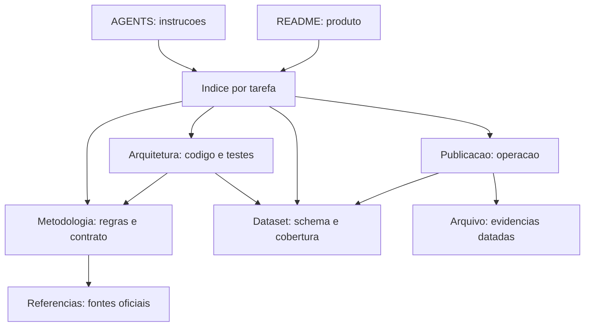

# Mapa de contexto

Este indice orienta a leitura incremental. Comece por [AGENTS.md](../AGENTS.md) para trabalhar no repositorio ou pelo [README](../README.md) para conhecer o produto; depois escolha o assunto. Dados de mercado completos so precisam ser carregados para validar ou calcular resultados.

## Documentos principais

| Assunto | Fonte principal | Relacoes |
| --- | --- | --- |
| Produto, inicio rapido e limites | [README](../README.md) | Encaminha para este indice e operacao |
| Instrucoes de trabalho | [AGENTS.md](../AGENTS.md) | Define invariantes e manutencao |
| Formulas, datas, entradas/saidas e paridade | [Metodologia](metodologia.md) | Implementada pelo nucleo Python e JavaScript |
| Responsabilidades, dependencias e testes | [Arquitetura](arquitetura.md) | Liga modulos a verificacoes |
| Schema, cobertura e manifesto | [Dataset estatico](dataset-estatico.md) | Produzido pelo exportador; consumido pela UI |
| Publicacao, comandos e diagnostico | [Publicacao](publicacao.md) | Liga CI, dataset e site |
| Origem das series | [Referencias](referencias.md) | Sustenta metodologia e integracao BCB |
| Decisoes e evidencias antigas | [Arquivo](archive/README.md) | Consulta historica, fora da leitura padrao |

## Rotas de leitura

- **Calculo/datas:** metodologia → `services/calculations.py` → `assets/calculations.js` → testes de calculo e comparador.
- **Interface/grafico:** arquitetura → `assets/app.js`, `presentation.js`, `styles.css`, `index.html` → testes JS e navegador.
- **Dados ausentes/defasados:** publicacao → dataset estatico → `data_providers.py` e `cache.py` → testes de integracao/cache/exportacao.
- **Mudanca estrutural:** arquitetura → arquivos afetados → atualize este mapa e as referencias.

Os caminhos acima sao relativos a `armadilha_cdi/` para `services/` e a `public/` para `assets/`. O mapa detalhado de codigo e testes esta na arquitetura.

## Grafo de conhecimento documental

As arestas significam dependencia de leitura, nao prioridade normativa. Cada assunto possui uma fonte principal; os demais documentos devem apontar para ela. Os links nas tabelas permitem navegar sem depender de renderizacao Mermaid.

## Conservacao do contexto

Mantenha nomes de arquivos estaveis, links relativos e secoes por responsabilidade. Registre fatos observados com data e origem; diferencie-os de regras do produto. Nao copie snapshots de cobertura para instrucoes permanentes. Ao arquivar, mantenha o motivo e o sucessor no [indice historico](archive/README.md). Nao leia `archive/` recursivamente por padrao.
