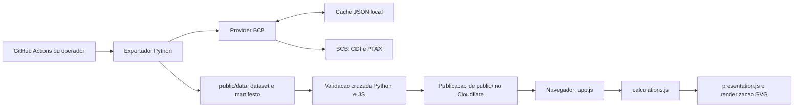

# Arquitetura

A unica superficie de publicacao e `public/`: JavaScript puro, SVG e JSON estatico. O site observado em 09/11/2026 e servido pelo Cloudflare Workers. Python opera fora da interacao do usuario, como referencia financeira e infraestrutura de dados.

Veja [metodologia](metodologia.md) para regras, [dataset](dataset-estatico.md) para schema e [publicacao](publicacao.md) para operacao.

## Responsabilidades e verificacao

| Modulo | Responsabilidade | Verificacao relacionada |
| --- | --- | --- |
| [calculations.py](../armadilha_cdi/services/calculations.py) | Validacao, datas efetivas, CDI, fallback PTAX e resultado | [test_calculations.py](../tests/test_calculations.py) |
| [calculations.js](../public/assets/calculations.js) | Regra equivalente no navegador e series do grafico | [calculations.test.js](../tests/js/calculations.test.js), comparador |
| [presentation.js](../public/assets/presentation.js) | Derivados e linhas de apresentacao BRL/cambio/USD | [presentation.test.js](../tests/js/presentation.test.js) |
| [app.js](../public/assets/app.js) | Carregamento/validacao basica do JSON, formulario, avisos e SVG | [static_ui_copy.test.js](../tests/js/static_ui_copy.test.js) para textos; navegador para interacao |
| [index.html](../public/index.html), [styles.css](../public/assets/styles.css) | Estrutura, acessibilidade e layout | Inspecao no navegador |
| [data_providers.py](../armadilha_cdi/services/data_providers.py) | Consulta BCB, normalizacao e sincronizacao incremental | [test_data_providers.py](../tests/test_data_providers.py) |
| [cache.py](../armadilha_cdi/services/cache.py) | Cache JSON, merge, lock por arquivo e escrita atomica | [test_cache.py](../tests/test_cache.py) |
| [models.py](../armadilha_cdi/models.py), [exceptions.py](../armadilha_cdi/exceptions.py), [config.py](../armadilha_cdi/config.py) | Contratos de dados, erros e constantes | Testes dos consumidores |
| [export_static_market_data.py](../scripts/export_static_market_data.py) | Geracao do dataset/manifesto e validacao de schema/segredos | [test_static_export.py](../tests/test_static_export.py) |
| [sync_market_data.py](../scripts/sync_market_data.py) | Sincronizacao manual/agendada do cache | Testes de provider/cache |
| [validate_static_reference_cases.py](../scripts/validate_static_reference_cases.py) | Compara Python e JS via [runner Node](../scripts/js_calculate_static.mjs) | [Periodos de referencia](../tests/fixtures/static_reference_periods.json) |

## Grafo de execucao

O grafo representa o processo operacional; o comparador recebe o dataset como entrada e nao transforma seus dados. A publicacao depende da configuracao externa do Cloudflare. No navegador, `app.js` carrega o dataset diretamente; o manifesto auxilia a operacao e nao e consultado pela UI atual.

## Fronteiras

- O nucleo Python e a referencia financeira; o JavaScript preserva seus resultados. A metodologia descreve o contrato compartilhado.
- As series do grafico sao construidas em `calculations.js`; formatacao e derivados ficam em `presentation.js`; desenho SVG fica em `app.js`.
- Cache em `cache/cdi.json` e `cache/usd.json` e operacional, ignorado pelo Git e fora do artefato publicado.
- A validacao completa do dataset e feita pelo exportador; a UI faz verificacoes basicas, sem consultar o BCB.
- `.github/workflows/tests.yml` roda testes Python e JS. `.github/workflows/update-static-market-data.yml` tambem exporta, compara as implementacoes e commita somente os dois JSON de dados.
- Nao ha runtime web Python, segunda pagina publicada ou dependencia de notebook/script exploratorio.

## Configuracao externa

O repositorio nao possui configuracao Wrangler versionada. O dominio `workers.dev` e o check `Workers Builds: armadilhadocdi` foram observados na verificacao datada. Nao deduza comandos de deploy ou configuracao de bindings a partir dos antigos guias de Pages; confira o painel ao alterar a hospedagem. A pasta a publicar permanece `public/`.
